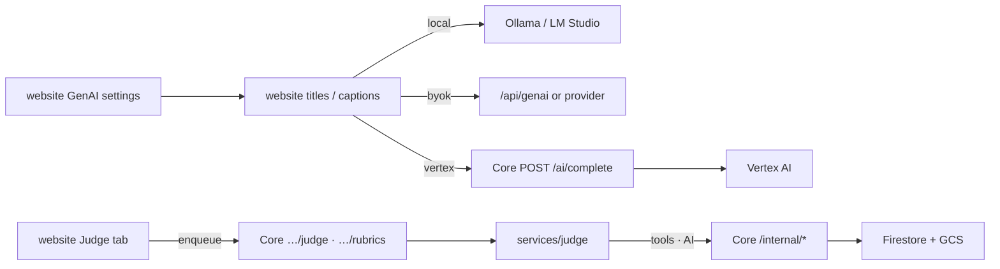

# Plan: Browser GenAI titles; Core Vertex proxy; Agents removed

**Status:** completed (superseded for Judge by [ADR-007](../../02-architecture/decisions/ADR-007-python-langgraph-judge.md))  
**Created:** 2026-10-17  
**Audience:** engineering + product  
**Related:** [ADR-004](../../02-architecture/decisions/ADR-004-agents-genai-gateway.md), [ADR-005](../../02-architecture/decisions/ADR-005-genai-in-core.md), [ADR-003](../../02-architecture/decisions/ADR-003-byok-keys-local.md), [FR-genai-judge](../features/FR-genai-judge.md)

Website runs **titles/captions** GenAI. **Core** exposes Vertex `/ai/complete` and internal AI/tools for the Judge worker. `services/agents` deleted. Notebook **Judge** is a server job (`services/judge`), not a browser audit loop — see ADR-007 and FR-genai-judge.

---

## Final shape

| Layer | Owns |
| --- | --- |
| **Website** | Titles/captions loop; Judge UI (enqueue + SSE); BYOK/local for titles |
| **Core** | ACL tools, rubrics/judgments, **Vertex** `/ai/complete` + `/internal/ai/*` |
| **Website `/api/genai`** | BYOK CORS BFF only |
| **`services/judge`** | Normalize + score LangGraph jobs |
| **`services/agents`** | Removed |

---

## Goals (met)

1. Titles/captions: one browser path for local / BYOK / Vertex.
2. Judge: tool-using server job; no full-notebook mega-prompt; no `/audits` collection.
3. Core: Vertex `/ai/complete`; BYOK titles stay browser/`/api/genai`; Agents gone.
4. BYOK keys out of Firestore ([ADR-003](../../02-architecture/decisions/ADR-003-byok-keys-local.md)).

## Non-goals

- Cloud Run → user `localhost` for titles.
- Keeping Agents “for modularity” when it only wraps Core data.
- Browser-orchestrated rubric scorecards (retired).

---

## Phases (historical checklist)

### Phase 0–4 — done

- [x] ADR-005 + overview; Agents removed from compose / Cloud Run / CI; `services/agents` deleted.
- [x] Core Vertex `POST /ai/complete`; website titles via local / BYOK / Vertex.
- [x] Judge moved to Python worker + rubrics/judgments ([ADR-007](../../02-architecture/decisions/ADR-007-python-langgraph-judge.md)); `/audits` removed.

## Exit criteria

- [x] No Agents process.
- [x] Titles browser-orchestrated; Judge server-side; Core owns tools + Vertex + rubrics/judgments.
- [x] No keys in Firestore preferences.
