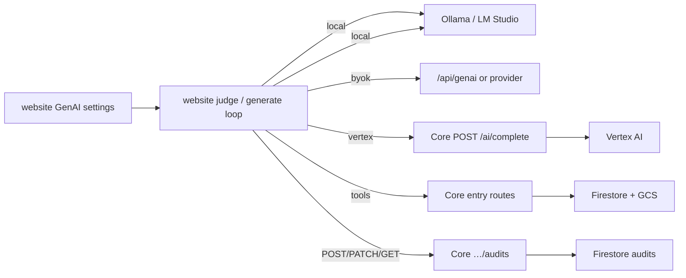

# Plan: Browser GenAI orchestration; Core tools + Vertex proxy

**Status:** active  
**Created:** 2026-10-17  
**Audience:** engineering + product  
**Related:** [ADR-004](../../02-architecture/decisions/ADR-004-agents-genai-gateway.md), [ADR-005](../../02-architecture/decisions/ADR-005-genai-in-core.md), [ADR-003](../../02-architecture/decisions/ADR-003-byok-keys-local.md), [FR-genai-audit](../features/FR-genai-audit.md)

Website runs all GenAI/judge loops. **Core** (not a separate Agents process) exposes ACL’d notebook tools, audit CRUD, and Vertex `/v1/infer`. Retire `services/agents` once migrated.

---

## Target shape

| Layer | Owns |
| --- | --- |
| **Website** | Judge/generate loop; progress UI; BYOK/local inference |
| **Core** | ACL tools, audit run + progress, **Vertex-only** `/ai/complete` |
| **Website `/api/genai`** | BYOK CORS BFF only |
| **`services/agents`** | Legacy until removed |

---

## Goals

1. One browser judge path for local / BYOK / Vertex.
2. Tool-using audit; no full-notebook mega-prompt.
3. Core: Vertex `/ai/complete` + multi-request audits; BYOK stays browser/`/api/genai`; drop Agents.
4. BYOK keys out of Firestore ([ADR-003](../../02-architecture/decisions/ADR-003-byok-keys-local.md)).

## Non-goals

- Server-side product judge loops.
- MCP.
- Cloud Run → user `localhost`.
- Keeping Agents “for modularity” when it only wraps Core data.

---

## Phases

### Phase 0 — Align contracts · P0

- [x] ADR-005 + overview: three services (website, Core, Collab); Agents marked legacy.
- [x] api-contracts: client topology, BFF definition, Next `/api` disposition, Core `/ai/complete` + audits; Agents legacy.

### Phase 1 — Website provider + infer client · P0

- [x] Judge resolves `local` | `byok` (`/api/genai`) | `vertex` (Core `/ai/complete`) from settings + grants.
- [x] Vertex only when `platformAi` / service_admin (enforced on Core `/ai/complete`).

### Phase 2 — Move/build on Core · P0

- [x] Core: Vertex-only `POST /ai/complete`; audits `POST` / `PATCH` / `GET`.
- [x] Website audits + Vertex on Core (no Agents base URL).
- [x] Stop deploying Agents in compose + Cloud Run + CI.

### Phase 3 — Browser judge loop · P0

- [x] Loop: start audit → list/read entries → model → PATCH progress → scorecard.
- [ ] Polish progress UI; smoke local / BYOK / Vertex deny+allow (manual).

### Phase 4 — Remove Agents · P1

- [x] Removed from compose / Cloud Run / CI / env examples.
- [x] Delete `services/agents` directory.

---

## Exit criteria

- [x] No required Agents process in local or prod.
- [x] One browser judge path; Core owns tools + audits + Vertex infer.
- [x] No keys in Firestore preferences.
