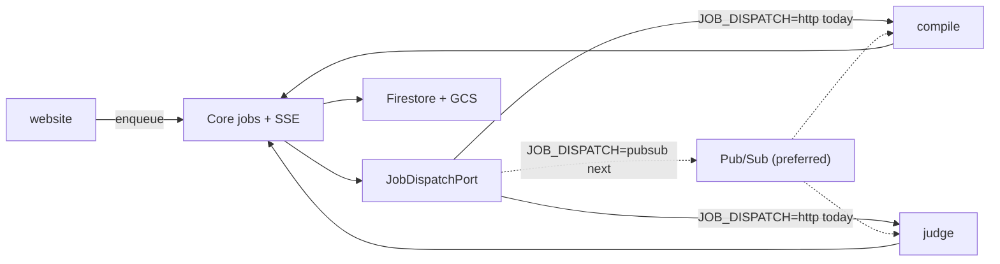

# Async jobs (Core jobs + workers)

**Status:** shipped for `compile` and `judge` (local HTTP dispatch); **Pub/Sub dispatch** preferred next for local↔prod parity.  
**ADRs:** [ADR-006](./decisions/ADR-006-compile-job.md), [ADR-007](./decisions/ADR-007-python-langgraph-judge.md), [ADR-008](./decisions/ADR-008-job-dispatch-evolution.md).  
**Sequences:** [diagrams.md](./diagrams.md).

## Goal

Long work (full-notebook PDF, LangGraph judge) must not run inside a Core request timeout. Pattern:

1. UI → Core `POST …/jobs` (or `POST …/compile`)  
2. Core writes durable job doc + optional lock (single-flight)  
3. `JobDispatchPort` wakes a worker  
4. Worker calls Core **internal** APIs; Core emits SSE `job.progress` / `job.done` / `job.failed`

## What is shipped

| Piece | Local | Notes |
| --- | --- | --- |
| Job docs + locks | yes | `…/jobs/{jobId}`, single-flight per type/resource |
| `compile` worker | Compose `compile` | XeLaTeX; [services/compile](../../services/compile/README.md) |
| `judge` worker | Compose `judge` | Python LangGraph; [services/judge](../../services/judge/README.md) |
| Dispatch | `JOB_DISPATCH=http` | `COMPILE_SERVICE_URL` / `JUDGE_SERVICE_URL` |
| UI progress | SSE | Not browser → worker |

`services/agents` was removed; GenAI/judge tooling lives in website + Core (+ judge worker).

## What is next (dispatch evolution)

Per [ADR-008](./decisions/ADR-008-job-dispatch-evolution.md):

1. **`JOB_DISPATCH=pubsub`** — Core publishes; workers subscribe. Compose runs the **Pub/Sub emulator** with the **same topic/subscription names** as GCP so local testing matches prod 1:1.  
2. Keep job docs / SSE / worker internal APIs unchanged.  
3. Optional: `JOB_DISPATCH=tasks` (Cloud Tasks) as an alternate port if needed — not the preferred parity story.  
4. HTTP remains until Pub/Sub lands, then fallback.

## Related

- Env: [env-vars.md](../03-reference/env-vars.md) (`JOB_DISPATCH`, worker URLs)  
- Local: [local-development.md](../04-guides/local-development.md)  
- Roadmap: [roadmap.md](../00-product/roadmap.md) · Issue [#93](https://github.com/msoe-vex/engineering-notebook-editor/issues/93)
