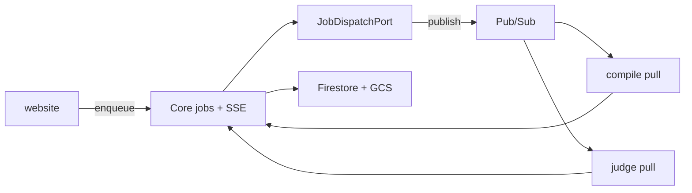

# Async jobs (Core jobs + workers)

**Status:** shipped for `compile` and `judge` with **Pub/Sub-only** wake (`JobDispatchPort`).  
**ADRs:** [ADR-006](./decisions/ADR-006-compile-job.md), [ADR-007](./decisions/ADR-007-python-langgraph-judge.md), [ADR-008](./decisions/ADR-008-job-dispatch-evolution.md).  
**Sequences:** [diagrams.md](./diagrams.md).

## Goal

Long work must not run inside a Core request timeout. Pattern:

1. UI → Core `POST …/jobs` (or `POST …/compile`)  
2. Core writes durable job doc + optional lock  
3. `JobDispatchPort` **publishes** to Pub/Sub  
4. Worker **pulls** subscription and runs; reports via Core internal APIs + SSE

## Topics / subscriptions (local = GCP names)

| Job type | Topic | Subscription |
| --- | --- | --- |
| compile | `notebook-jobs-compile` | `notebook-jobs-compile-worker` |
| judge | `notebook-jobs-judge` | `notebook-jobs-judge-worker` |

Compose: `pubsub` emulator + `pubsub-init`. Env: `JOB_DISPATCH=pubsub`, `PUBSUB_EMULATOR_HOST`, `GOOGLE_CLOUD_PROJECT`.

`JOB_DISPATCH=none` disables wake (tests). HTTP Core→worker wake is **retired**.

## Related

- Env: [env-vars.md](../03-reference/env-vars.md)  
- Local: [local-development.md](../04-guides/local-development.md)  
- Issue [#93](https://github.com/msoe-vex/engineering-notebook-editor/issues/93)
