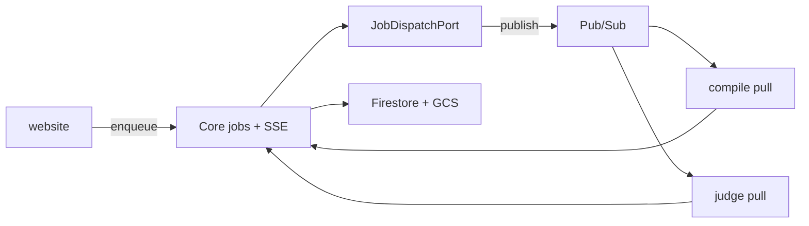

# Async jobs (Core jobs + workers)

**Status:** shipped for `compile` and `judge` with **Pub/Sub-only** wake (`JobDispatchPort`).  
**ADRs:** [ADR-006](./decisions/ADR-006-compile-job.md), [ADR-007](./decisions/ADR-007-python-langgraph-judge.md), [ADR-008](./decisions/ADR-008-job-dispatch-evolution.md).  
**Sequences:** [diagrams.md](./diagrams.md).

## Goal

Long work must not run inside a Core request timeout. Pattern:

1. UI → Core `POST …/jobs` (or `POST …/compile`)  
2. Core writes durable job doc + optional lock  
3. `JobDispatchPort` **publishes** to Pub/Sub  
4. Worker **pulls** subscription and runs; reports via Core internal APIs + SSE

## Topics / subscriptions (local = GCP names)

| Job type | Topic | Subscription |
| --- | --- | --- |
| compile | `notebook-jobs-compile` | `notebook-jobs-compile-worker` |
| judge | `notebook-jobs-judge` | `notebook-jobs-judge-worker` |

Compose: `pubsub` emulator + `pubsub-init`. Env: `JOB_DISPATCH=pubsub`, `PUBSUB_EMULATOR_HOST`, `GOOGLE_CLOUD_PROJECT`.

`JOB_DISPATCH=none` disables wake (tests). HTTP Core→worker wake is **retired**.

## Blob IO (workers → Core only)

Compile and judge **never** talk to the object store SDK. Bytes flow through Core internal APIs; Core uses `StoragePort` (GCS adapter).

| Direction | API |
| --- | --- |
| TipTap / assets / rubric source **read** | `GET /internal/storage/object?orgId&notebookId&key=` (key from snapshot / `gcsKeys`) |
| Compile snapshot (paths only) | `GET /internal/compile/snapshot` |
| Asset path resolve | `GET /internal/compile/asset-ref` |
| Export PDF **write** | `PUT /internal/compile/export` |
| Judge rubric meta / progress / complete | `/internal/judge/*` |

**Allowed keys** for `/internal/storage/object`: under `organizations/{orgId}/notebooks/{notebookId}/` **or** org assets `organizations/{orgId}/assets/`. Object-key layout: [schema.md](../03-reference/schema.md#object-key-contract-adapter-agnostic).

**Exceptions (not product workers):** ops upload script `infra/scripts/upload-busytex-assets.ts` uses the GCS SDK directly to seed static BusyTeX/LaTeX keys. Website and Collab never open the blob store — Collab loads/flushes Yjs via Core `/internal/collab/*`.

## Progress SSE

Workers call Core progress endpoints; Core fans out `job.progress` with `status` (human message), `progress` (0–100), and optional **`stage`** / **`detail`** (compile uses `fetch` | `tex` | `xelatex` | `upload`). Website Compile UI shows stage + a short rolling log; durable loading toasts are notebook-scoped ([public-collab plan Epic B](../01-requirements/plans/public-collab-comments-polish.md)).

## Related

- Env: [env-vars.md](../03-reference/env-vars.md)  
- Local: [local-development.md](../04-guides/local-development.md)  
- Ports: [ADR-009](./decisions/ADR-009-platform-ports.md), [platform-ports Epic B](../01-requirements/plans/platform-ports.md)  
- Issue [#93](https://github.com/msoe-vex/engineering-notebook-editor/issues/93)
