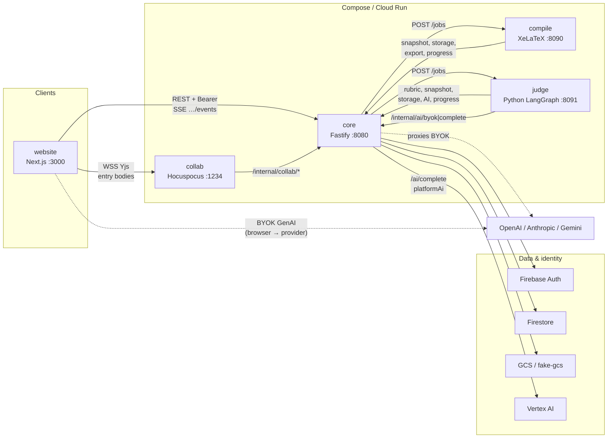
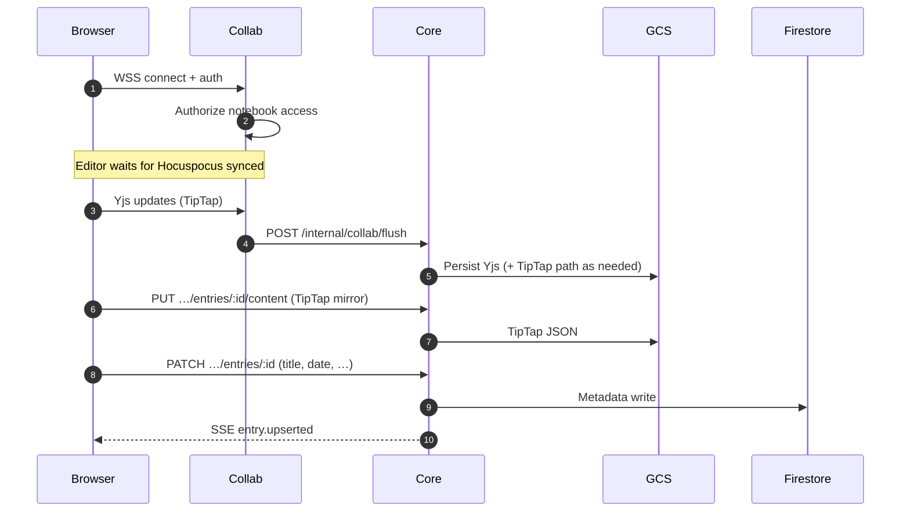
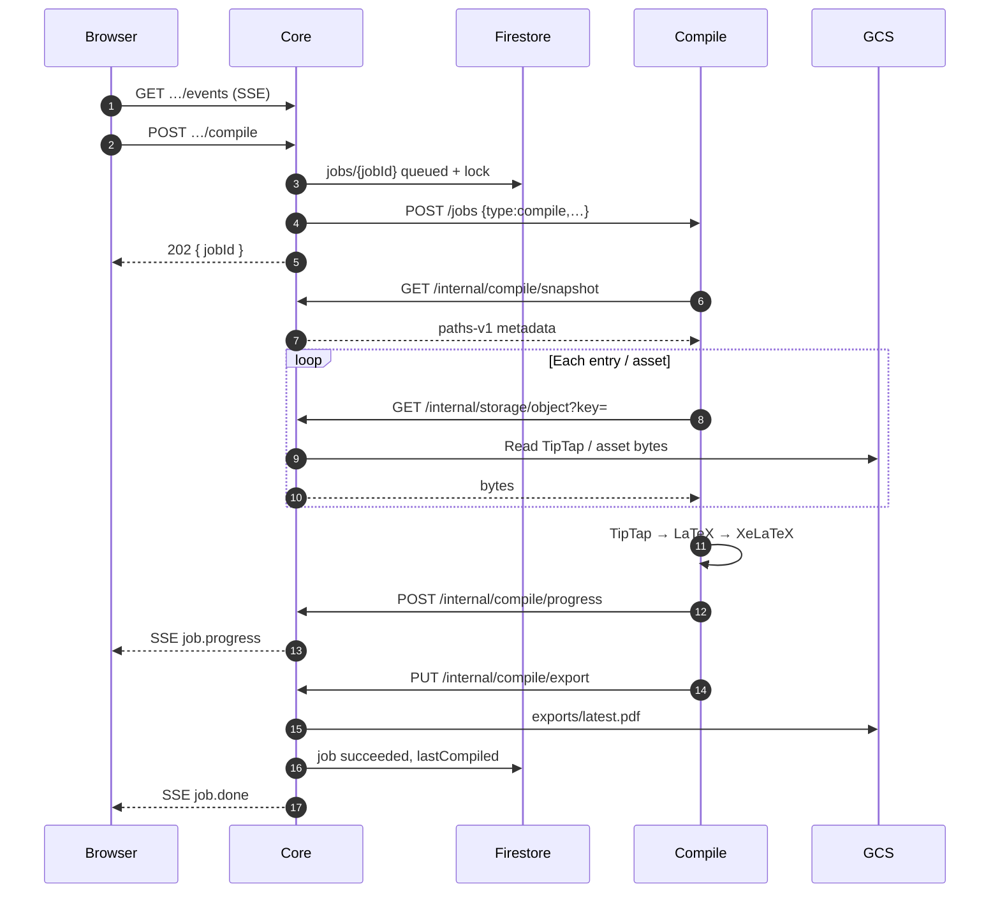
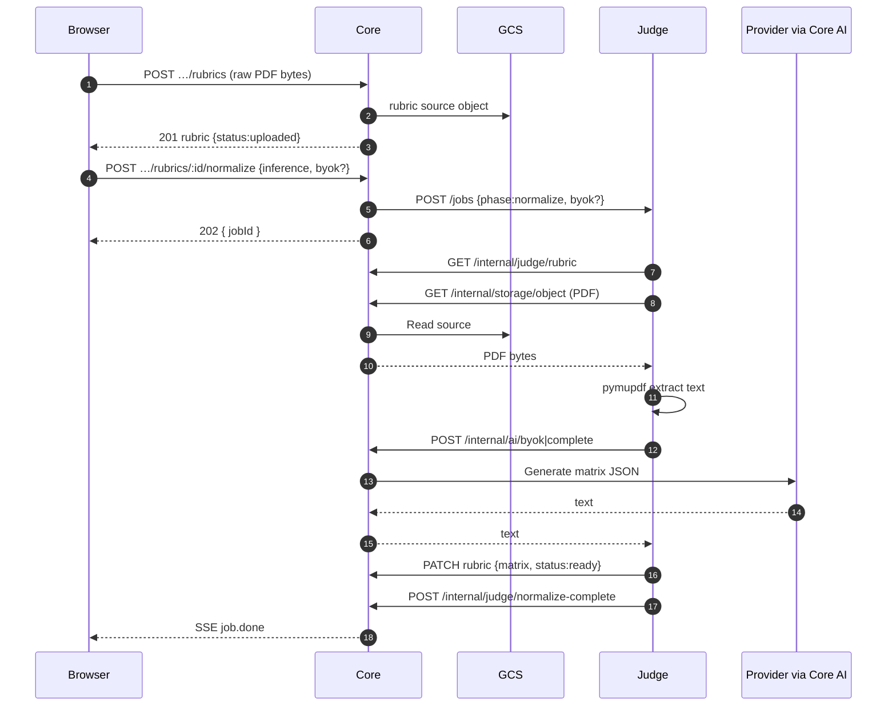
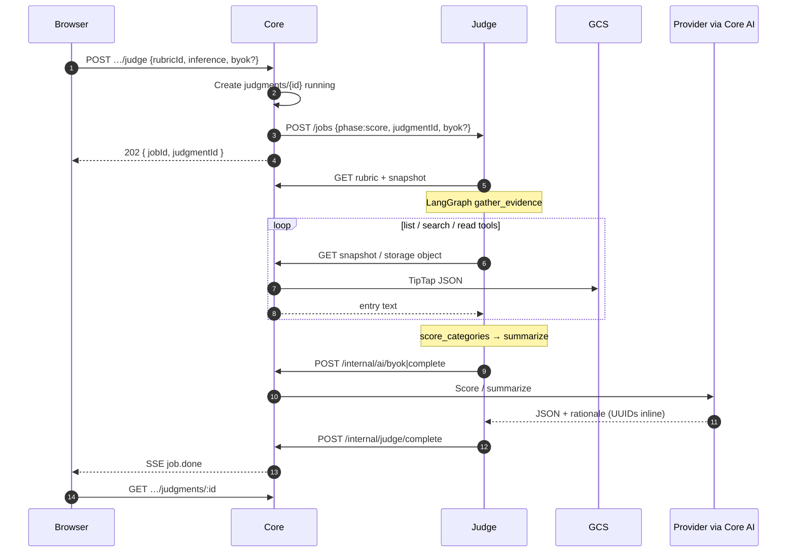
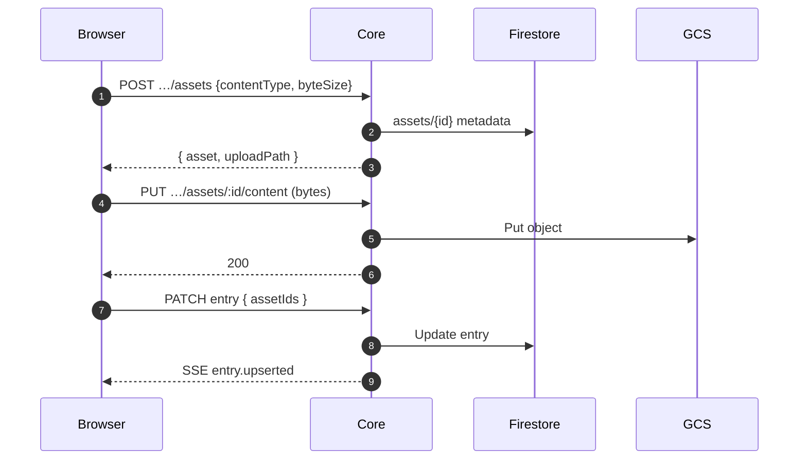
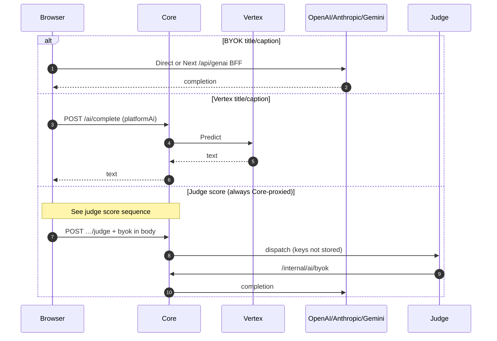
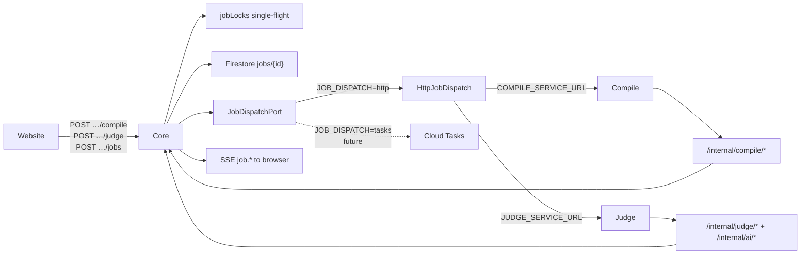

# Architecture diagrams

Canonical pictures of how services talk. Contracts stay in [api-contracts](../03-reference/api-contracts.md); decisions in [ADRs](./decisions/). Related narrative: [overview](./overview.md), [realtime](./realtime.md), [tenancy-acl](./tenancy-acl.md).

## System context

Browser clients talk to **Core** (REST + SSE) and **Collab** (Yjs WSS). Workers never accept browser traffic — Core dispatches jobs over the internal network.

### Ports (local)

| Service | Port | Public to browser? |
| --- | --- | --- |
| website | 3000 | yes |
| core | 8080 | yes (REST/SSE) |
| collab | 1234 | yes (WSS) |
| compile | 8090 | **no** (Core only) |
| judge | 8091 | **no** (Core only) |
| firebase emulators | 9099 / 8081 / 4000 | yes (dev) |
| fake-gcs | 4443 | Core / workers (Docker DNS) |

---

## Sequence: collaborative entry edit

Bodies sync over Collab; metadata over Core SSE. Detail: [realtime.md](./realtime.md).

---

## Sequence: async compile job

UI never calls the compile worker. Single-flight via `jobLocks`. See [ADR-006](./decisions/ADR-006-compile-job.md).

---

## Sequence: judge — normalize rubric

Upload stores the PDF; extract/normalize is a separate job (`phase=normalize`).

---

## Sequence: judge — score notebook (LangGraph)

Score requires a ready matrix. Worker gathers evidence with tools, then scores. See [ADR-007](./decisions/ADR-007-python-langgraph-judge.md).

---

## Sequence: asset upload

Browser uploads through Core (avoids GCS CORS). Collab/editor references `asset.id` in TipTap.

---

## Sequence: GenAI title / caption (BYOK vs Vertex)

Judge always goes through Core for inference. Titles/captions may call the provider from the browser (BYOK) or Core Vertex.

---

## Job dispatch (Core → worker)

