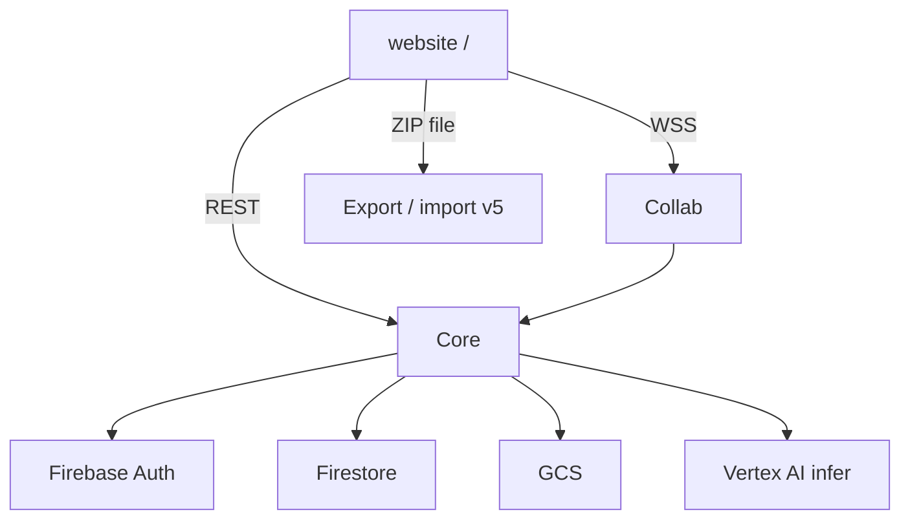

# Architecture overview

**Live storage:** Firestore + GCS on GCP only. **Realtime:** Hocuspocus/Yjs.  
**Not used for sync:** GitHub, local FS, S3 (ZIP backup only; LWW — [ADR-001](./decisions/ADR-001-gcp-only-sync.md), [ADR-002](./decisions/ADR-002-zip-lww-backup.md)).

- Docs index: [../README.md](../README.md)
- Local testing: [../04-guides/local-development.md](../04-guides/local-development.md)
- API: [../03-reference/api-contracts.md](../03-reference/api-contracts.md)
- Schema: [../03-reference/schema.md](../03-reference/schema.md)
- Requirements: [../01-requirements/](../01-requirements/)
- ACL: [tenancy-acl.md](./tenancy-acl.md) · Realtime: [realtime.md](./realtime.md)

## Services

| Service | Role | Port |
| --- | --- | --- |
| [`website/`](../../website/README.md) | App UI at `/` (+ ZIP backup); server compile jobs | 3000 |
| [`services/core/`](../../services/core/README.md) | Auth, tenancy, metadata, assets, GenAI tools / audits / Vertex infer — [ADR-005](./decisions/ADR-005-genai-in-core.md) | 8080 |
| [`services/collab/`](../../services/collab/README.md) | Yjs rooms → flush to Core/GCS | 1234 |
| [`services/compile/`](../../services/compile/README.md) | XeLaTeX worker for `type=compile` jobs — [ADR-006](./decisions/ADR-006-compile-job.md) | 8090 |

Website runs GenAI/judge loops; BYOK/local infer in browser (or `/api/genai` BFF); Core is Vertex `/ai/complete` + audit progress + entry tools — [ADR-004](./decisions/ADR-004-agents-genai-gateway.md), [api-contracts](../03-reference/api-contracts.md).

## Data

| Data | Store |
| --- | --- |
| Users, orgs, members, entry metadata | Firestore |
| TipTap JSON, Yjs, binaries, BusyTeX | GCS |
| Concurrent editing | Yjs over WSS |

## Production

[`infra/cloudrun/deploy.sh`](../../infra/cloudrun/deploy.sh) — see [deploy-cloudrun.md](../04-guides/deploy-cloudrun.md).
