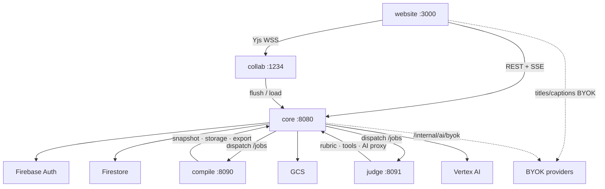

# Architecture overview

**Live storage:** Firestore + GCS on GCP only. **Realtime:** Hocuspocus/Yjs.  
**Not used for sync:** GitHub, local FS, S3 (ZIP backup only; LWW — [ADR-001](./decisions/ADR-001-gcp-only-sync.md), [ADR-002](./decisions/ADR-002-zip-lww-backup.md)).

**Diagrams (system + sequences):** [diagrams.md](./diagrams.md)

- Docs index: [../README.md](../README.md)
- Local testing: [../04-guides/local-development.md](../04-guides/local-development.md)
- API: [../03-reference/api-contracts.md](../03-reference/api-contracts.md)
- Schema: [../03-reference/schema.md](../03-reference/schema.md)
- Requirements: [../01-requirements/](../01-requirements/)
- ACL: [tenancy-acl.md](./tenancy-acl.md) · Realtime: [realtime.md](./realtime.md)

## Services

| Service | Role | Port | Talks to |
| --- | --- | --- | --- |
| [`website/`](../../website/README.md) | App UI; ZIP backup; orchestrates compile/judge jobs via Core | 3000 | Core REST/SSE, Collab WSS, BYOK providers |
| [`services/core/`](../../services/core/README.md) | Auth, tenancy, metadata, assets, jobs, Vertex, internal APIs — [ADR-005](./decisions/ADR-005-genai-in-core.md) | 8080 | Firestore, GCS, Auth, Vertex, workers |
| [`services/collab/`](../../services/collab/README.md) | Yjs rooms; flush bodies to Core/GCS | 1234 | Core `/internal/collab/*` |
| [`services/compile/`](../../services/compile/README.md) | XeLaTeX worker (`type=compile`) — [ADR-006](./decisions/ADR-006-compile-job.md) | 8090 | Core internal only |
| [`services/judge/`](../../services/judge/README.md) | Python LangGraph judge (`type=judge`) — [ADR-007](./decisions/ADR-007-python-langgraph-judge.md) | 8091 | Core internal only |

Workers are **not** browser-reachable. Job progress returns on Core SSE (`job.progress` / `job.done` / `job.failed`). Full communication map and sequences: [diagrams.md](./diagrams.md).

Website GenAI routing: [ADR-004](./decisions/ADR-004-agents-genai-gateway.md). Contracts: [api-contracts](../03-reference/api-contracts.md).

## Data

| Data | Store |
| --- | --- |
| Users, orgs, members, entry metadata, jobs, rubrics, judgments | Firestore |
| TipTap JSON, Yjs, assets, rubric sources, export PDFs | GCS |
| Concurrent editing | Yjs over WSS (Collab) |

## Production

[`infra/cloudrun/deploy.sh`](../../infra/cloudrun/deploy.sh) — see [deploy-cloudrun.md](../04-guides/deploy-cloudrun.md).
