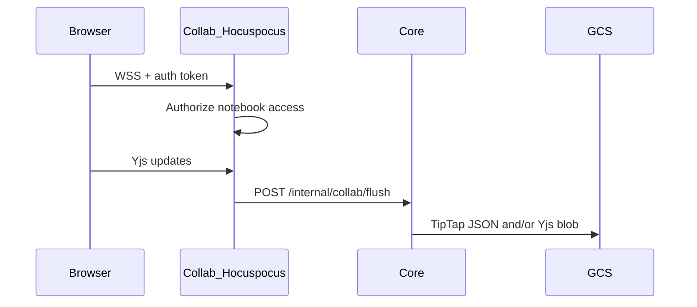
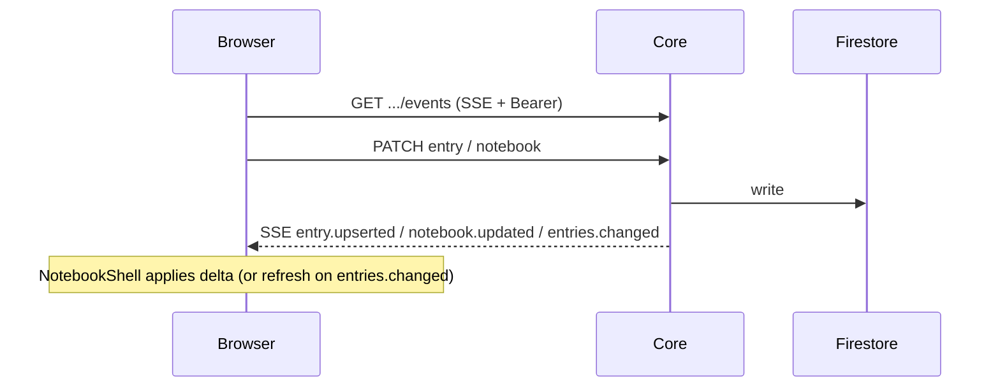

# Realtime collaboration

Related: [FR-entries-collab](../01-requirements/features/FR-entries-collab.md), [api-contracts](../03-reference/api-contracts.md), [cloud UX plan Epic E](../01-requirements/plans/cloud-ux-hardening.md).

## Two channels

| Concern | Transport | Service | Store |
| --- | --- | --- | --- |
| Entry **body** (TipTap) | Hocuspocus / Yjs WSS | Collab | GCS (flush via Core) |
| Entry / notebook **metadata** | Core SSE (`GET …/notebooks/:id/events`) | Core | Firestore |

Website does **not** open Firestore listeners. Collab does **not** own metadata fanout.

## Document naming (body)

```
org:{orgId}:notebook:{notebookId}:entry:{entryId}
```

## Body flow



## Metadata flow



Core authorizes the SSE subscription the same way as REST (`canAccessNotebook`). Events are notebook-scoped. Website uses `fetch` + stream parser (EventSource cannot set `Authorization`).

## Notes

- Debounced flush from Collab → Core
- TipTap JSON written when real JSON supplied; Yjs always may persist
- Website densifies metadata for calendar/settings via `workspaceState` (not legacy store); today refreshed by full fetch — push replaces that for multi-client freshness
- Local smoke may set `COLLAB_AUTH_DISABLED=true` — never in production
