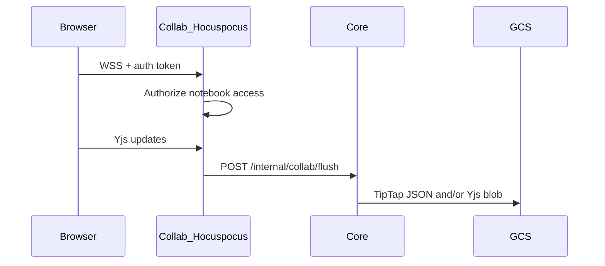

# Realtime collaboration

Related: [FR-entries-collab](../01-requirements/features/FR-entries-collab.md), [api-contracts](../03-reference/api-contracts.md).

## Document naming

```
org:{orgId}:notebook:{notebookId}:entry:{entryId}
```

## Flow



## Notes

- Debounced flush from Collab → Core
- TipTap JSON written when real JSON supplied; Yjs always may persist
- Website densifies metadata for calendar/settings via `workspaceState` (not legacy store)
- Local smoke may set `COLLAB_AUTH_DISABLED=true` — never in production
