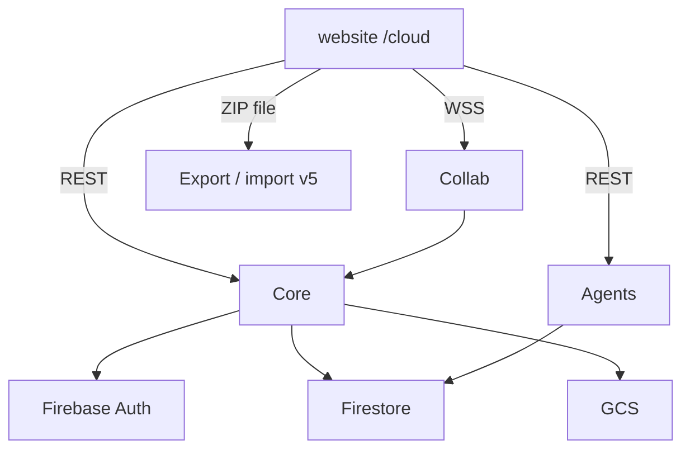

# Microservices architecture

**Live storage:** Firestore + GCS on GCP only. **Realtime:** Hocuspocus/Yjs.  
**Not used for sync:** GitHub, local FS, S3 (ZIP backup only; LWW adapters later).

- Local testing: [local-development.md](./local-development.md)
- API contracts: [api-contracts.md](./api-contracts.md)
- Root: [../README.md](../README.md)

## Services

| Service | Role | Port |
| --- | --- | --- |
| [`website/`](../website/README.md) | `/cloud` UI (+ ZIP backup) | 3000 |
| [`services/core/`](../services/core/README.md) | Auth, tenancy, metadata, assets, BusyTeX | 8080 |
| [`services/collab/`](../services/collab/README.md) | Yjs rooms → flush to Core/GCS | 1234 |
| [`services/agents/`](../services/agents/README.md) | Rubric audit BYOK / Vertex grant | 8000 |

## Data

| Data | Store |
| --- | --- |
| Users, orgs, members, entry metadata | Firestore |
| TipTap JSON, Yjs, binaries, BusyTeX | GCS |
| Concurrent editing | Yjs over WSS |

## Production

[`infra/cloudrun/deploy.sh`](../infra/cloudrun/deploy.sh)
