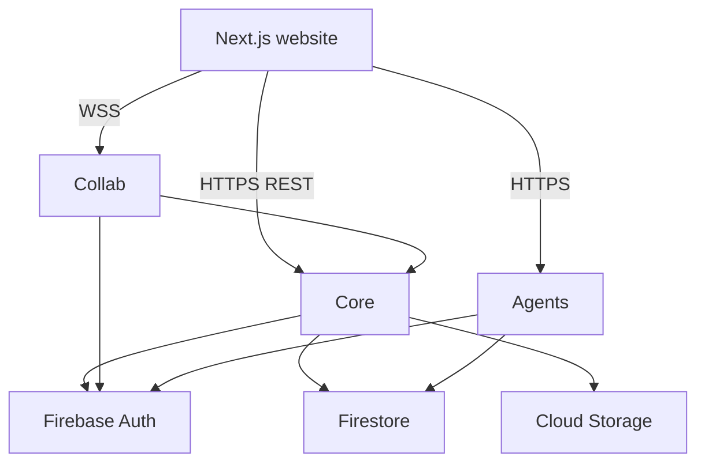

# Microservices architecture

Cloud Run–oriented layout with nested organization tenancy.

For **how to run and test locally**, see [local-development.md](./local-development.md).  
For **HTTP/WSS contracts**, see [api-contracts.md](./api-contracts.md).  
Root overview: [../README.md](../README.md).

## Services

| Service | Role | Default port |
| --- | --- | --- |
| [`website/`](../website/README.md) | Next.js — classic Home + `/cloud` | 3000 |
| [`services/core/`](../services/core/README.md) | Firebase AuthPort, orgs/notebooks/entries/assets, admin, BusyTeX static | 8080 |
| [`services/collab/`](../services/collab/README.md) | Hocuspocus/Yjs; flush to Core/GCS | 1234 |
| [`services/agents/`](../services/agents/README.md) | Rubric audit; BYOK + `grants.platformAi` Vertex | 8000 |
| [`packages/shared/`](../packages/shared) | v5 types, path helpers, ZIP migrate | — |
| [`infra/docker-compose.yml`](../infra/docker-compose.yml) | Emulators + fake-gcs + all services | — |

## Data stores

| Data | Store |
| --- | --- |
| Users, orgs, members, invites, entry metadata | Firestore under `organizations/{orgId}/…` |
| TipTap JSON, Yjs blobs, notebook binary assets, BusyTeX | GCS |
| Live editing | Yjs over WSS (Collab → Core flush) |

Entry Firestore docs stay **metadata + GCS pointers only** (TipTap bodies are never embedded).

## Tenancy & roles

- **Service Administrator** — `users/{uid}.platformRole === service_admin` (platform Admin UI)
- **Org Owner / Admin / Member** — `organizations/{orgId}/members/{uid}.role`
- Notebook access in v1 = org membership (no separate notebook roles)

## Production

[`infra/cloudrun/deploy.sh`](../infra/cloudrun/deploy.sh) + root README “Cloud Run deployment”.
